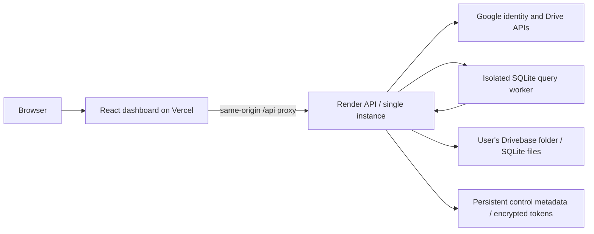

# Drivebase

A personal database server with a Vercel dashboard, a Render API, and database files stored in each user's Google Drive. SQL tables and JSON document collections share a SQLite engine.

**Status:** MVP implementation. Type checks and production compilation are part of delivery; live Google authorization and deployed end-to-end testing belong to the next testing phase. This is a small-workload prototype, not a production database service.

## Included

- Responsive database dashboard, database creation, and account connection view.
- SQL editor with table discovery, query history for the current tab, query results, and keyboard execution.
- JSON document collections with create/update/delete, IDs, and pagination.
- Downloadable SQLite databases.
- Google sign-in plus `drive.file` consent; a visible `Drivebase` folder created in the user's Drive.
- Encrypted refresh tokens, opaque hashed sessions, tenant ownership checks, and request origin validation.
- Per-database request serialization and isolated query workers with a timeout.
- Local development mode with filesystem storage and no Google credentials.
- Vercel configuration and a Render Blueprint with a persistent control-data disk.

## Run locally

Requires Node **22.12+** and npm. From the repository root:

```sh
npm ci
npm run dev
```

Open **http://localhost:5173** and choose **Open local workspace**. The API runs on port 4000. Development mode stores metadata and database files under `apps/api/.data/`; these files are ignored by Git. Do not expose development mode to the internet.

No `.env` is required for local mode. To configure Google, copy `apps/api/.env.example` to `apps/api/.env` and follow [Google setup](docs/DEPLOYMENT.md#google-setup). The API workspace loads its own `.env` when launched through npm.

```sh
npm run typecheck
npm run build
```

Build outputs are `apps/api/dist/` and `apps/web/dist/`. `npm start` starts the compiled API only. The frontend is served by Vercel in deployment and Vite during development.

## Architecture



The API downloads the selected database for each operation, executes against an in-memory SQLite working copy, and uploads changed bytes before responding with success. Working database copies are not treated as durable. JSON collections use a private SQLite table and a separate HTTP interface; this is document CRUD, not MongoDB wire-protocol compatibility.

The UI is React with Vite. Vercel hosts static assets and proxies `/api` to Render. This keeps session cookies on the frontend origin without depending on third-party cookies. OAuth callbacks also pass through that same frontend origin. The Google redirect URI must use the frontend domain.

## Storage and operational limits

- Run **one API process and one service instance**. Locks are in-process. Do not run clustered Node workers, multiple replicas, or two deployments against the same account files.
- Default database limit: **10 MiB**; account limit: **10 databases**. The limit can be lowered through configuration; this prototype caps it at 10 MiB and applies a matching SQLite page limit.
- Each operation transfers the whole SQLite file. Large or write-heavy databases are unsuitable for this design.
- SQL supports one statement per request, with up to 500 returned rows, a default five-second worker timeout, and a 128 MiB JS heap limit per worker. WASM memory is not fully governed by the JS heap limit; strict total-memory isolation is future work.
- Concurrent requests for one database are serialized. External edits, multiple writers, and cross-file transactions are unsupported.
- A failed/timed-out Drive upload can have an uncertain outcome. Refresh and read back before retrying. There is no exactly-once request protocol or automatic write retry.
- Session expiry is seven days. Revoked Google access requires reconnecting. No Drive API tokens are sent to browser JavaScript.
- Control metadata is an atomic JSON file on the Render disk, rather than a separate Postgres service. It includes users, encrypted tokens, hashed sessions, and the database catalog. Back up this disk separately: losing it loses account-to-file mappings and sessions. Database files remain in Drive, but catalog recovery/import is not implemented.
- The server needs a stable `TOKEN_ENCRYPTION_KEY`. Changing or losing it makes existing refresh tokens unreadable; users must reconnect.
- User-created SQL triggers are not supported. JSON editing accepts object documents, with a 256 KiB request limit and 100 documents per list page.
- API keys, a public SDK, database deletion/import, backups/version restore, sharing, and distributed coordination are outside this MVP.

## Deployment and testing

See [deployment instructions](docs/DEPLOYMENT.md), [API reference](docs/API.md), and the [MVP acceptance checklist](docs/TESTING.md). No live cloud deployment is implied by the presence of these configuration files.

## References

- [Google Drive file-specific permission scope](https://developers.google.com/workspace/drive/api/guides/api-specific-auth)
- [Google OAuth for web servers](https://developers.google.com/identity/protocols/oauth2/web-server)
- [Render persistent disks](https://render.com/docs/disks)
- [sql.js SQLite engine](https://sql.js.org/)
